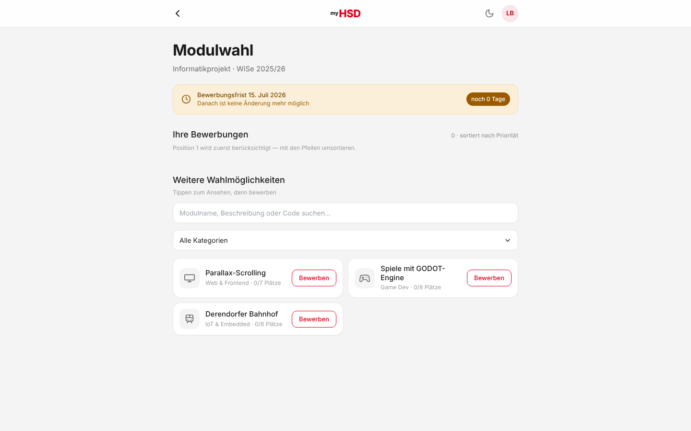
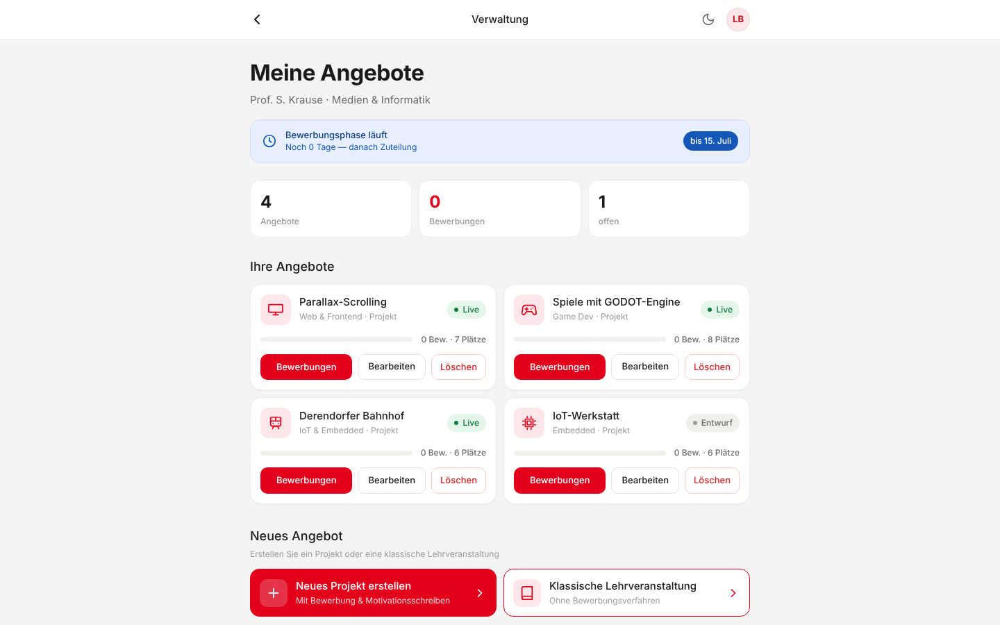
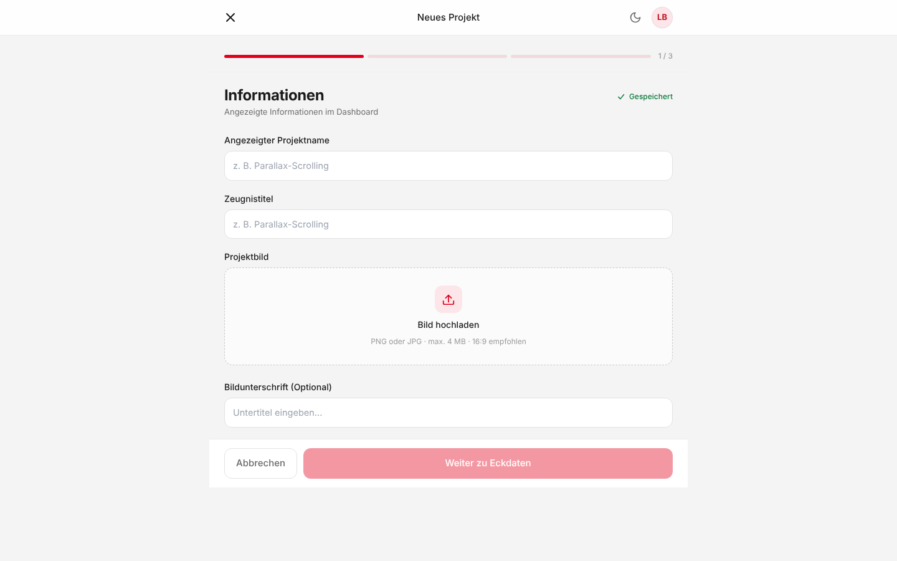
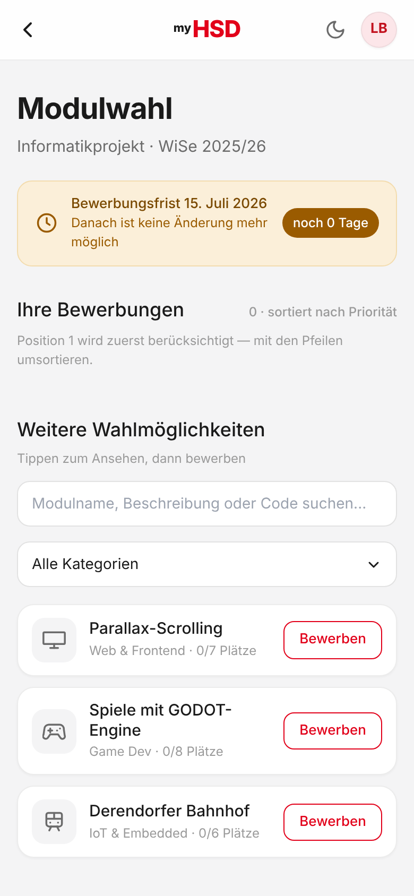

# myHSD Modulwahl

Prototyp einer **responsiven Web-App** für die Modul- und Projektwahl im Studium:
Studierende bewerben sich priorisiert auf Projekte, Lehrende legen Angebote an und
vergeben Plätze. Entstanden als Semesterprojekt im Modul *Interaktive Systeme*
an der Hochschule Düsseldorf (Fachbereich Medien), SoSe 2026.

**Stack:** Next.js 15 (App Router) · React 19 · TypeScript · Tailwind CSS

> ℹ️ Inoffizieller Studierenden-Prototyp. Alle Personen und Daten sind fiktive Beispieldaten;
> es gibt kein Backend, der Zustand liegt im `localStorage` des Browsers.

| Studierende | Lehrende |
|---|---|
|  |  |
|  |  |

## Mein Beitrag

Teamprojekt. Mein Anteil (rund die Hälfte des aktuellen Codes):

- **Grundgerüst der App:** Next.js-Projekt aufgesetzt und die Seiten für beide Rollen
  (Studierende/Lehrende) responsiv nach dem gemeinsamen Design-Entwurf umgesetzt
- **UI-Komponenten:** Button, StatusChip, Icon-Set, ImageUpload
- **Bearbeiten-Flow, Bewerbungszähler und Zusagen/Absagen** fertig umgesetzt
- **Bild-Upload:** clientseitige Verkleinerung per Canvas und Speicherung als Data-URL

Weitere Features (globaler State/Context, Multi-User-Logik, Datepicker, Dark Mode,
Anbindung der Modulhandbuch-API) haben meine Teammitglieder umgesetzt.

## Zwei Rollen

Beim Start (`/`) wählt man eine Rolle:

### Studierende
- **`/studierende`** — Modulübersicht: Bewerbungen nach Priorität sortieren (↑/↓),
  Bewerbungsfrist, weitere Wahlmöglichkeiten.
- **`/projekt/[id]`** — Projektdetail mit Eckdaten und Aktionen.
- **`/bewerbung/[id]`** — Bewerbungsformular (Motivationsschreiben + Gruppenwunsch)
  mit Autospeichern.

### Lehrende
- **`/lehrende`** — Dashboard: eigene Angebote (anlegen/bearbeiten/löschen),
  Statistik, Kapazitätsanzeige.
- **`/lehrende/bewerbungen/[id]`** — Bewerbungen prüfen: Zusagen/Ablehnen
  (für Studierende sichtbar), Filter, Live-Platzzähler.
- **`/lehrende/neuProjekt`** — Assistent „Neues Projekt": Name, Zeugnistitel,
  Bild, Kategorie, Beschreibung, Teilnehmerzahl, Studiengang- & Semester-Zuordnung.
- **`/lehrende/neuKLV`** — Assistent „Klassische Lehrveranstaltung" (mit
  Modulhandbuch-Auswahl, ohne Bewerbungsverfahren).
- **`/lehrende/bearbeiten/[id]`** — bestehendes Angebot bearbeiten
  (Name, Kategorie, Beschreibung, Plätze, Live/Entwurf).

Angebote, Bewerbungen, Entscheidungen und Projektbilder werden im **localStorage**
des Browsers gehalten — sie überleben einen Reload, sind aber pro Browser/Gerät lokal.
Hochgeladene Bilder (PNG/JPG, max. 4 MB) werden clientseitig auf 1280 px verkleinert
und als JPEG-Data-URL gespeichert, damit die localStorage-Quota (~5 MB) reicht.

## Lokal starten

Voraussetzung: **Node.js ≥ 18** (empfohlen 20+).

```bash
npm install      # Abhängigkeiten installieren
npm run dev      # Entwicklungsserver starten
```

Dann im Browser öffnen: **http://localhost:3000**

Weitere Befehle:

```bash
npm run build    # Produktions-Build erstellen
npm run start    # Produktions-Build lokal starten
```

## Technik

- **Next.js 15** (App Router) + **React 19**
- **TypeScript**
- **Tailwind CSS** (Design-Tokens in `tailwind.config.ts`)
- **Dark Mode**: Ein globaler Light/Dark-Mode-Umschalter (Sonne/Mond-Symbol) mit automatischer `localStorage`-Persistierung und maßgeschneiderten, augenschonenden CSS-Überschreibungen in `globals.css`.
- **Düsseldorfer Modulhandbuch-API Integration**: Dynamischer Abruf von Modul- und Studiengangsdaten zur automatischen Befüllung bei der KLV-Erstellung.
- **Dynamische Kategorien**: Flexibler Kategorie-Manager zur Laufzeit (Erstellung eigener Kategorien mit Name + Icon-Zuweisung).
- **Dynamische Fristenberechnung**: Der Countdown verbleibender Tage berechnet sich in Echtzeit relativ zur aktuellen Uhrzeit des Endgeräts.
- Schriftart **Inter**

## Projektstruktur

```
src/
├─ app/
│  ├─ page.tsx                       Rollenauswahl (Start)
│  ├─ studierende/                   Studierenden-Übersicht (Modulwahl, Suche & Dropdown-Filter)
│  ├─ projekt/[id]/                  Projektdetail (Eckdaten, Startdatum, Bewerbungs-Status)
│  ├─ bewerbung/[id]/                Bewerbungsformular (Motivationsschreiben + Gruppenwunsch)
│  └─ lehrende/
│     ├─ page.tsx                    Lehrenden-Dashboard (Meine Angebote)
│     ├─ bewerbungen/[id]/           Bewerbungen prüfen & Zuteilen
│     ├─ neuKLV/                     Assistent „Neue Lehrveranstaltung“ (mit Handbuch-Auswahl & Pflichtfeldern)
│     ├─ neuProjekt/                 Assistent „Neues Projekt“ (mit Pflichtfeldern)
│     └─ bearbeiten/[id]/            Angebot bearbeiten (Kategorie, Beschreibung, Startdatum, Entwurf/Live)
├─ components/                       Wiederverwendbare UI-Elemente (AppShell, Button, StatusChip, Icons, ImageUpload)
├─ context/                          OfferingsContext (Globale Verwaltung von Angeboten, Entscheidungen und Custom-Kategorien)
├─ data/                             Beispieldaten & Definitionen (projects, lehrende)
└─ store/                            Autosave-State der Studierenden (Motivationen, Gruppenwünsche, Prioritäten-Order)
```

## Design

Das UI ist **responsiv**: dieselbe Gestaltung funktioniert am Telefon (eine Spalte)
und am Desktop (mehrspaltige Raster, breiterer Inhalt). HSD-Branding: Rot `#E2001A`,
Schwarz, Weiß.
